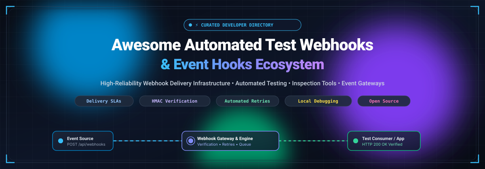

# 🚀 Awesome Automated Test Webhooks & Event Hooks

**A curated index of production-ready webhook delivery infrastructure, automated testing frameworks, debugging gateways, and event-driven architecture tools.**

---

## 📑 Table of Contents

- [🔍 Overview](#-overview)
- [📊 Sector Overview & Market Dynamics](#-sector-overview--market-dynamics)
- [💼 SaaS Webhook Platforms](#-saas-webhook-platforms)
- [🌐 Open-Source Webhook Infrastructure & Testing Tools](#-open-source-webhook-infrastructure--testing-tools)
- [🗂️ Category Breakdown](#️-category-breakdown)
  - [1. 📤 Dedicated Webhook Delivery Infrastructure](#1--dedicated-webhook-delivery-infrastructure)
  - [2. 🧪 Webhook Testing, Inspection & Mocking](#2--webhook-testing-inspection--mocking)
  - [3. ⚡ Workflow & Event Orchestration Platforms](#3--workflow--event-orchestration-platforms)
- [📋 Webhook Architecture & Testing Checklist](#-webhook-architecture--testing-checklist)
- [💖 Support](#-support)
- [🤝 Contributing](#-contributing)
- [📈 Star History](#-star-history)
- [📄 License](#-license)

---

## 🔍 Overview

Modern cloud and web applications depend heavily on asynchronous event-driven architectures. Building and maintaining reliable webhook infrastructure requires addressing complex challenges: ensuring guaranteed at-least-once delivery, exponential backoff retries with jitter, cryptographic HMAC verification, local developer tunneling, replay debugging, and high-throughput queuing.

This repository compiles verified developer tools across **commercial SaaS platforms** and **open-source systems** designed for dispatching, inspecting, mocking, and end-to-end automated testing of webhooks.

---

## 📊 Sector Overview & Market Dynamics

The global market encompassing Event-Driven Architecture (EDA) platforms and Integration Platform as a Service (iPaaS) is estimated at **$15.6 Billion to $19.1 Billion** (projected to exceed $50 Billion by 2030 at a 22–30% CAGR), with dedicated Webhook-as-a-Service (WaaS) and delivery infrastructure serving as a rapidly expanding developer-tooling segment.

The sector exhibits **moderate fragmentation**: high-level enterprise workflow automation has consolidated around multi-billion-dollar incumbents (Celonis/Make, Zapier, Workday/Pipedream), whereas the programmatic webhook delivery infrastructure, local debugging bins, and event gateway layer remain highly competitive and developer-driven, prioritizing open standards (such as Standard Webhooks), cryptographic security, and low-latency throughput.

---

## 💼 SaaS Webhook Platforms

The table below lists leading commercial SaaS products supporting webhook delivery, testing, or event triggers, sorted in descending order by **Company Scale (Valuation / Revenue)**.

| 🏢 Platform | 🎯 Category & Primary Role | 💰 Company Scale (Valuation / Revenue) | 🏷️ Starting Paid Tier Pricing | 🎁 Free Tier Limits / Free Trial Policy | ⚡ Key Capabilities & SLAs |
|:---|:---|:---|:---|:---|:---|
| **[Make](https://www.make.com/)** | 🔄 Visual Workflow & Webhook Automation | **~$13.0 Billion** valuation *(Celonis SE; $400M+ ARR)* | **$9.00 / mo** *(billed annually at $108/yr; or $10.59/mo monthly for Core plan)* | **Free Forever**: 1,000 operations/month, 2 active scenarios, 15-minute execution interval, 100 MB data transfer | Visual execution builder, 3,500+ connectors, instant webhook triggers, custom payload formatting |
| **[Zapier](https://zapier.com/)** | ⚡ Workflow & Event Automation | **~$5.0 Billion** valuation *(~$310M ARR)* | **$19.99 / mo** *(billed annually at $239.88/yr; or $29.99/mo monthly for Professional plan with 750 tasks)* | **Free Forever**: 100 tasks/month, 2-step single-trigger Zaps only, 15-minute polling update interval | 7,000+ app connectors; *Webhooks by Zapier* available as a Premium app on paid plans |
| **[Pipedream](https://pipedream.com/)** | 💻 Developer Integration & Serverless Workflows | **~$100 Million** valuation *(Acquired by Workday; $22M VC raised)* | **$29.00 / mo** *(Basic workflow plan) or $99.00/mo (Startup Connect plan)* | **Free Forever**: 100 daily compute credits (~3,000 credits/mo), 3 active workflows, 333 events/sec rate limit | Serverless Node.js/Python code steps, native webhook endpoints, pre-built auth for 2,000+ APIs |
| **[RequestBin](https://requestbin.com/)** | 🔍 Webhook Capture & HTTP Inspection | **~$100 Million** valuation *(Operated under Pipedream)* | **$12.00 / mo** *(RequestBin Pro plan via Pipedream)* | **Free Forever**: 3 active public bins, 500 requests per bin per day, 100 requests history log per bin | Dedicated HTTP/Webhook request logger, visual inspector, JSON body inspection, replay triggers |
| **[Courier](https://www.courier.com/)** | 📬 Multi-Channel Notification & Webhook Dispatch | **~$100 Million** valuation *($12.5M VC raised)* | **$0.005 / notification send** *(Business tier baseline on usage)* | **Free Forever**: 10,000 notification sends/month, access to SDKs, CLI, MCP server, all channels | Multi-channel routing engine (Email, SMS, Push, Slack, Webhooks), automated failover, send logs |
| **[Svix](https://www.svix.com/)** | 🛡️ Webhooks-as-a-Service Delivery Infrastructure | **~$30 Million** valuation *($13.1M VC raised; Series A led by a16z)* | **$20.00 / mo** *(Basic plan, includes 100K messages/mo; +$0.40 per additional 10K)* | **Free Forever**: 50,000 messages/month, 50 msgs/second rate limit, 7-day message retention, consumer portal | Dedicated outbound delivery, automatic HMAC signing, exponential backoff, developer portal UI, 99.9% SLA |
| **[Hookdeck](https://hookdeck.com/)** | 🌉 Webhook Infrastructure & Event Gateway | **~$30 Million** valuation *($3.0M VC raised; Matrix Partners seed; ~$880K ARR)* | **$39.00 / mo** *(Team plan) or $10.00 / 1M events (Outpost Pay-As-You-Go)* | **Free Forever**: 10,000 inbound events/month, 3-day data retention, 5 destinations, 10 rules, CLI tunnel | Inbound event gateway & outbound Outpost, rate limiting, automatic retry logic, message queuing, local CLI |
| **[Webhook.site](https://webhook.site/)** | 🧪 Webhook Inspection, Testing & Custom Actions | **~$3 Million** valuation *(Bootstrapped; ~$500K ARR, 3,000+ paid accounts)* | **$9.00 / mo** *(billed monthly, or $90.00/yr for Basic plan)* | **Free Forever**: Instant temporary URLs (expire after 7 days inactivity), 50 requests per URL limit | Real-time browser display, Custom Actions workflow scripts, automated forwarding, email webhook testing |

---

## 🌐 Open-Source Webhook Infrastructure & Testing Tools

The following genuine open-source webhook solutions are actively maintained and sorted in descending order by **GitHub Stars_Count**. Each repository badge links directly to its stargazers page.

| 📦 Repository | ⭐ GitHub_Stars_Badge | 💻 Primary Language | 📝 Description & Primary Use Case |
|:---|:---:|:---:|:---|
| **[adnanh/webhook](https://github.com/adnanh/webhook)** |  | Go | Lightweight, highly configurable incoming webhook server written in Go that runs arbitrary shell scripts, deployment commands, and CI tasks upon receiving HTTP requests. |
| **[webhooksite/webhook.site](https://github.com/webhooksite/webhook.site)** |  | PHP / Vue | Self-hostable edition of Webhook.site. Inspect, test, and debug incoming HTTP webhooks and API calls in real time using a reactive web dashboard. |
| **[svix/svix-webhooks](https://github.com/svix/svix-webhooks)** |  | Rust | Production-grade open-source webhooks-as-a-service backend. Provides secure signature generation, retries, event routing, and embeddable customer management dashboards. |
| **[frain-dev/convoy](https://github.com/frain-dev/convoy)** |  | Go | High-performance cloud-native webhooks gateway for both inbound and outbound events. Features rate limiting, payload security, event retries, and comprehensive delivery analytics. |
| **[standard-webhooks/standard-webhooks](https://github.com/standard-webhooks/standard-webhooks)** |  | Spec / Multi-SDK | Open specification and multi-language verification libraries (Python, Go, JS, Rust, Java, PHP) standardizing webhook signatures, headers, and timestamp replay prevention. |
| **[hook0/hook0](https://github.com/hook0/hook0)** |  | Rust / TS | Open-source Serverless Webhooks-as-a-Service (WaaS) provider designed to dispatch outbound webhooks to customer endpoints with built-in retries and subscription management. |
| **[tarampampam/webhook-tester](https://github.com/tarampampam/webhook-tester)** |  | Go / Vue | Standalone, lightweight containerized tool for capturing and inspecting incoming webhooks with real-time WebSocket notifications and mock HTTP responses. |
| **[darklynx/request-baskets](https://github.com/darklynx/request-baskets)** |  | Go | Self-hosted HTTP request collector service to test webhooks, notifications, and REST clients with configurable response simulation and forward proxy capabilities. |
| **[hookdeck/hookdeck-cli](https://github.com/hookdeck/hookdeck-cli)** |  | Go | Developer CLI tool to forward live webhooks to `localhost`, test inbound payload handling, replay failed events, and interface with the Hookdeck Event Gateway. |

---

## 🗂️ Category Breakdown

To avoid common architectural confusion, webhook tooling is categorized by core engineering responsibility:

### 1. 📤 Dedicated Webhook Delivery Infrastructure
*Send webhooks reliably to third-party endpoints at scale.*
- **Core Capabilities**: Outbound message queues, automatic exponential backoff retries, cryptographic HMAC-SHA256 payload signing, timestamp anti-replay checks, customer self-serve endpoint portals, and uptime delivery SLAs.
- **Top Solutions**: [Svix](https://www.svix.com/), [Hookdeck Outpost](https://hookdeck.com/), [Convoy](https://github.com/frain-dev/convoy), [Hook0](https://github.com/hook0/hook0).

### 2. 🧪 Webhook Testing, Inspection & Mocking
*Capture, debug, and validate incoming webhooks during development and automated CI/CD.*
- **Core Capabilities**: Instant public endpoints, real-time HTTP payload/header inspectors, configurable mock responses, request replay, and local tunnel forwarding.
- **Top Solutions**: [Webhook.site](https://webhook.site/), [RequestBin](https://requestbin.com/), [Webhook Tester](https://github.com/tarampampam/webhook-tester), [Request Baskets](https://github.com/darklynx/request-baskets), [Hookdeck CLI](https://github.com/hookdeck/hookdeck-cli).

### 3. ⚡ Workflow & Event Orchestration Platforms
*Trigger broader enterprise workflows based on external webhook events.*
- **Core Capabilities**: Visual node pipelines, conditional routing, data transformation across hundreds of disparate SaaS APIs, and event-driven triggers.
- **Top Solutions**: [Make](https://www.make.com/), [Zapier](https://zapier.com/), [Pipedream](https://pipedream.com/).

---

## 📋 Webhook Architecture & Testing Checklist

When implementing production-grade automated webhook testing and delivery pipelines, ensure compliance with these architectural standards:

1. 🔐 **Cryptographic Signatures**: Sign every outbound payload using HMAC-SHA256 (`webhook-signature`) and include a timestamp header (`webhook-timestamp`) to prevent replay attacks (refer to [Standard Webhooks](https://github.com/standard-webhooks/standard-webhooks)).
2. 🔁 **Idempotency Guarantees**: Pass a unique `webhook-id` in headers so downstream consumers can deduplicate events during network retries.
3. ⏳ **Exponential Backoff**: Implement jittered backoff schedules (e.g., immediate retry, then 5s, 1m, 15m, 1h, 6h, 12h) before marking deliveries as dead-lettered.
4. ⏱️ **Timeout Thresholds**: Enforce strict client timeouts (e.g., 5 seconds) to prevent slow consumer endpoints from holding connection pools open.
5. 🛠️ **Local Test Harnesses**: Use tools like [Hookdeck CLI](https://github.com/hookdeck/hookdeck-cli) or [Webhook Tester](https://github.com/tarampampam/webhook-tester) inside CI test runners to verify webhook receipt without public domain exposition.

---

## 💖 Support

Thank you for exploring this curated repository! If you find this directory helpful for your development workflow or projects:

- ⭐ **Star** this repository to show your appreciation and help other developers discover it!
- 🍴 **Fork** and contribute new tools, libraries, and frameworks.
- 📢 **Share** this collection on social media, developer forums, and Discord communities.
- ☕ **Buy me a coffee / Sponsor**: If you'd like to support ongoing maintenance and new developer curation projects, consider sponsoring via the **[GitHub Sponsors Dashboard](https://github.com/sponsors/ishandutta2007)**!

---

## 🤝 Contributing

Contributions are warmly welcomed! If you would like to suggest a new webhook infrastructure tool, testing framework, or specification:

1. Fork this repository.
2. Create a new branch: `git checkout -b feature/add-tool-name`.
3. Ensure open-source additions include active GitHub repositories and accurate categorization.
4. For SaaS tools, provide verifiable pricing tiers and documented free tier specifications.
5. Submit a Pull Request.

---

## 📈 Star History

---

## 📄 License

This project is open-source under the [MIT License](LICENSE).
